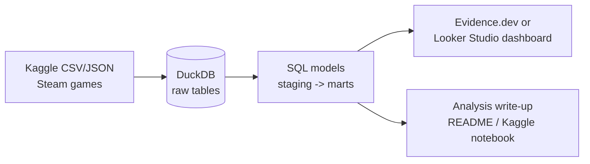
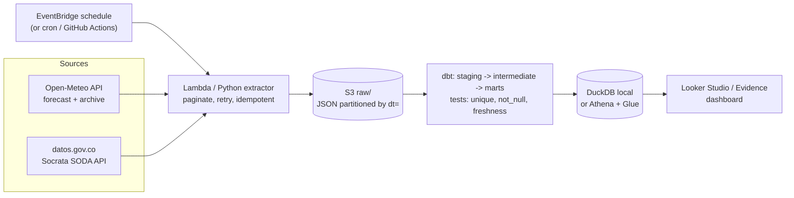
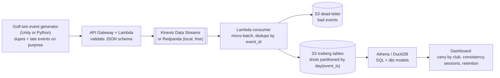
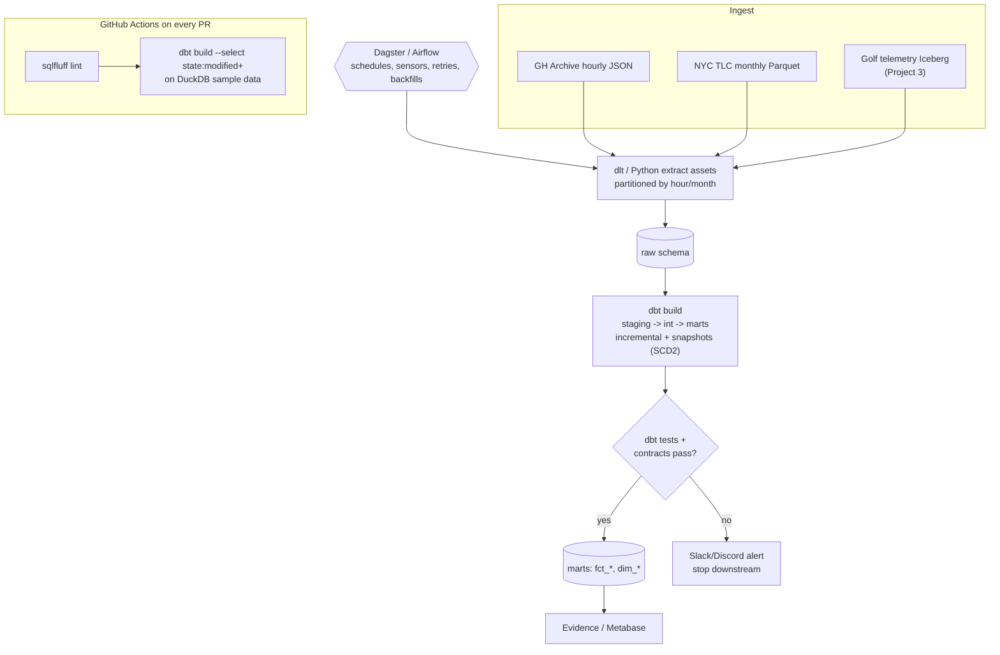
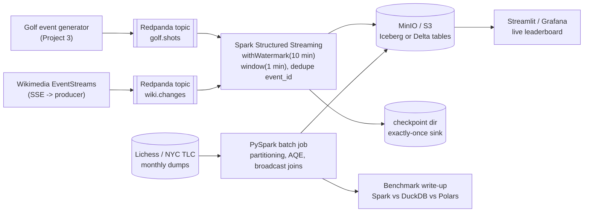

# 5 Portfolio Projects (Easy to Hard), All on Free Tiers

You already have the hard parts most career-switchers lack: production AWS (Lambda, API Gateway, Cognito), serverless analytics logging, Node/TS, Postgres, and a **Unity golf simulator that generates physics-rich events**. These projects put all of that into a data portfolio. Build them in order. Each one reuses the one before it.

| # | Project | Signals | Time | Role target |
|---|---|---|---|---|
| 1 | Steam market SQL analysis + dashboard | SQL, analytical thinking, storytelling | 1 week | Data Analyst |
| 2 | Weather + Colombian open data batch ELT | Ingestion, S3 data lake, dbt, testing | 1-2 weeks | Analytics Engineer / junior DE |
| 3 | ⭐ Golf-shot telemetry pipeline | Event pipelines, streaming-ish ingestion, Iceberg, game domain | 2-3 weeks | DE (your signature project) |
| 4 | Orchestrated warehouse with CI | Airflow/Dagster, data contracts, CI/CD, incremental models | 2-3 weeks | DE |
| 5 | Streaming + Spark | Kafka API, Spark Structured Streaming, watermarks, batch at scale | 3 weeks | Mid DE |

### "Free" honestly explained (checked 2026-11-21)
- **Fully free, always:** DuckDB, dbt Core, Dagster/Airflow (open source), Redpanda in Docker, Spark in Docker, MinIO, Evidence, Metabase (open source), Streamlit Community Cloud, Looker Studio, GitHub Actions on public repos, BigQuery sandbox (about 1 TB queries/month, no card).
- **AWS:** new accounts on the Free plan get up to **$200 in credits for 6 months**. The account closes when the credits run out or after 6 months, unless you upgrade. Older accounts keep the "always free" limits, e.g. Lambda's 1M requests/month.
- **Small costs on AWS:** Kinesis Data Streams is **not** free (you pay per shard-hour or on-demand). Athena charges $5 per TB scanned. For portfolio-sized data that is cents, and the credits cover it.
- Every project below has a **$0 local path** and an **AWS path**. Build the local path first, then put the AWS version on your résumé.
- Set an **AWS Budget alarm at $5** before you create any resource.

### Repo checklist (applies to every project)
- **README** with:
  - problem statement
  - architecture diagram (copy the Mermaid below)
  - how to run it (`make up` / `make run`)
  - data source and license
  - a screenshot of the dashboard
  - what you would do next
- **Reproducible setup:** `docker compose up`, plus a `Makefile` or `justfile`, plus `.env.example`. Never commit secrets.
- **Tests:** dbt tests and/or `pytest`, run in GitHub Actions on every push.
- **A short "Decisions" section** covering partitioning, idempotency and cost. This is what turns a tutorial into a portfolio piece.

---

## Project 1: Steam Market Analysis (SQL + dashboard)

**Goal:** answer 3 to 5 business questions about the PC game market with SQL alone, and present them in a public dashboard. For example:
- Which genres and price bands get the best review scores?
- Does early-access status hurt reviews?
- How did releases per year change, by tag?

**Why this one for you:** you know games, so your questions will be sharper than a generic tutorial's. It also builds the "analyst" muscle that DE interviews test as well.

**Stack (free):**
- Data: [Steam Games dataset (Kaggle)](https://www.kaggle.com/datasets/fronkongames/steam-games-dataset)
- DuckDB (local) or the BigQuery sandbox
- Looker Studio, or Evidence.dev (dashboards as code, deploys free)
- GitHub



**Steps:**
1. Download the data. Load it into DuckDB with `read_csv_auto` / `read_json_auto`.
2. Profile it: row counts, nulls, duplicates, price outliers, tag explosion. Write the findings down.
3. Build `stg_games` (typed, cleaned), `dim_tag` (one row per game-tag, from `unnest`) and `fct_game_reviews`.
4. Write one SQL file per business question. Use window functions for "top N per genre" and CTEs for readability.
5. Build a dashboard with 4 to 6 charts, each with a title that states the insight ("Indie games under $10 get 12 points better reviews").
6. Write a 1-page README: question, method, findings, caveats such as survivorship bias in Steam data.
7. Optional: publish the same work as a Kaggle notebook for extra visibility.

**Done when:** the dashboard has a public link, the repo runs from scratch with one command, and each finding cites its query.

**What hiring managers see:**
- You can turn vague questions into precise SQL.
- You clean data before trusting it.
- You communicate insights, not just tables.

This is exactly the DA screen, and the analytical half of a DE screen.

---

## Project 2: Batch ELT: Open-Meteo + datos.gov.co, from API to S3 to dbt to DuckDB/Athena to Looker Studio

**Goal:** a daily pipeline that pulls weather for Colombian cities plus a Colombian open-data source (e.g. road-accident records or public contracts). It lands the raw JSON in a data lake, models it with dbt, and serves a dashboard. Example question: *"Do road accidents rise on rainy days in Colombian cities?"*

**Why this one for you:** it is the standard modern data stack (ELT) and it runs on AWS you already know. The Colombian data gives you a local angle for Colombian and LATAM employers.

**Stack (free path):**
- Python with [dlt](https://dlthub.com/docs/intro) or plain `requests`
- Local folder or MinIO as the "S3"
- dbt Core + [dbt-duckdb](https://github.com/duckdb/dbt-duckdb)
- DuckDB
- Evidence / Looker Studio (through a Google Sheet or CSV export) / Metabase OSS

**Stack (AWS path):**
- Lambda on an EventBridge schedule writes to S3 (raw/ zone)
- Glue Data Catalog
- Athena
- dbt-athena



**Steps:**
1. Write an extractor for Open-Meteo that pulls hourly weather for 5 cities (Bogotá, Medellín, Cali, Barranquilla, Bucaramanga). Write the raw JSON to `raw/open_meteo/dt=YYYY-MM-DD/city.json`.
2. Write an extractor for one datos.gov.co dataset using `$limit`/`$offset` pagination and `$where` on a date column for incremental loads. Store the high-water mark (last loaded date) in a small state file or a DynamoDB item.
3. **Backfill:** use the Open-Meteo archive endpoint for the last 12 months. Make the extractor accept `--start --end`, and make re-runs overwrite the same partition. That is what idempotent means, and interviewers ask about it.
4. dbt project:
   - `stg_weather` and `stg_accidents`, with type casting, renaming to snake_case English names and timezone normalization (America/Bogota)
   - `int_daily_city_weather`
   - `fct_accidents_by_day_weather`
5. Add tests: `unique`, `not_null`, `accepted_values` (city), `relationships`, plus a **source freshness** check.
6. Schedule it with EventBridge, or with a cron in GitHub Actions on the free path.
7. Build the dashboard, then write a README section on partitioning, idempotency and cost (Athena bytes scanned per query).

**Done when:** a day's run is a no-op if the data already exists, a backfill of any date range works, `dbt build` is green in CI, and the dashboard refreshes daily.

**What hiring managers see:** you know the ELT pattern, including the hard parts:
- incremental loads
- backfills
- idempotency
- lake partitioning
- dbt with tests

Also, you can do this on AWS with real IAM rather than just in a notebook.

---

## Project 3 ⭐: Golf-Shot Telemetry Pipeline (your signature project)

**Goal:** simulate realistic golf-shot events: ball speed, launch angle, spin, club, player, device, timestamp, with late-arriving and duplicate events on purpose. Stream them through a queue into a Lambda consumer, store them as Apache Iceberg tables on S3, query with Athena, and build a player-performance dashboard.

**Why this one for you:** you have built ball physics and serverless analytics logging. This project shows a DE hiring manager the same skills in their vocabulary. In interviews you can say *"I modeled the telemetry from a simulator I built."*

**Stack (free path):**
- Python or Node/TS event generator (reuse your physics formulas or a simple carry model)
- Redpanda (Kafka API) in Docker
- Python consumer (stands in for Lambda)
- MinIO + [PyIceberg](https://py.iceberg.apache.org/) with a SQL/REST catalog
- DuckDB with the [iceberg extension](https://duckdb.org/docs/stable/core_extensions/iceberg/overview)
- Streamlit / Evidence

**Stack (AWS path):**
- API Gateway → Lambda producer (your existing pattern)
- Kinesis Data Streams on-demand. Turn it off after demos: it is not free.
- Lambda consumer ([Kinesis trigger](https://docs.aws.amazon.com/lambda/latest/dg/with-kinesis.html)) writes Iceberg via PyIceberg + Glue catalog. Alternative: [Firehose → Iceberg](https://docs.aws.amazon.com/firehose/latest/dev/apache-iceberg-destination.html).
- [Athena on Iceberg](https://docs.aws.amazon.com/athena/latest/ug/querying-iceberg.html)
- Looker Studio / QuickSight trial / Streamlit



**Event contract (write it first and version it):**
```json
{
  "event_id": "uuid",
  "event_type": "shot_hit",
  "schema_version": 1,
  "player_id": "p_123",
  "session_id": "s_456",
  "device": "simulator_bay",
  "club": "7I",
  "ball_speed_mph": 118.2,
  "launch_deg": 17.5,
  "spin_rpm": 6800,
  "carry_yds": 172.4,
  "event_ts": "2026-11-21T18:04:11.120Z",
  "sent_ts": "2026-11-21T18:04:11.480Z"
}
```

**Steps:**
1. Write the generator. Model 50 players with different skill levels. Make the shot distributions depend on club and skill, and make players improve over weeks. Inject 1% duplicate events, 2% late events (event_ts minutes or hours before sent_ts) and 0.5% malformed events.
2. Add an ingest endpoint with **JSON Schema validation**. Invalid events go to a dead-letter location and are never dropped silently.
3. Write a consumer that micro-batches events (e.g. 100 events or 60 seconds) and dedupes on `event_id`, e.g. with an Iceberg MERGE or "insert if not exists".
4. Create the Iceberg table, partitioned by `day(event_ts)` and **not** by arrival time. Show that late events land in the correct partition. Show **schema evolution** by adding `spin_axis_deg` in `schema_version: 2` without rewriting history.
5. Build dbt or SQL models: `fct_shots`, `fct_sessions` (sessionization with a 30-minute gap rule, see `sql-drills.md` Q31), `agg_player_club_daily` and a retention cohort (Q38).
6. Build the dashboard:
   - carry distribution by club
   - consistency (standard deviation of carry)
   - personal-best progression (Q26)
   - D1/D7 retention
   - events per minute
   - pipeline lag (`sent_ts - event_ts`)
7. Add an observability panel with event counts, DLQ counts, duplicates removed and p95 lag. For a DE role, monitoring is part of the product.
8. In the README, explain:
   - why Iceberg rather than plain Parquet (ACID, schema evolution, time travel)
   - how you handled late and duplicate data
   - the cost per million events on AWS

**Done when:**
- Replaying the same event file twice produces the same row counts (idempotent).
- Late events show up in the right day partition.
- Schema v2 events work alongside v1 events.
- The dashboard answers "is player X improving with their driver?"

**What hiring managers see:** you can design event contracts, handle real-world stream problems (duplicates, late data, schema drift, bad records) and use the lakehouse format (Iceberg) that many companies are adopting. Plus a memorable story that only you can tell.

---

## Project 4: Orchestrated Warehouse with Tests and CI (Airflow or Dagster)

**Goal:** take Projects 2 and 3 to production grade. Add an orchestrator with dependencies, retries, backfills and alerts. Add a dimensional warehouse with incremental models and SCD Type 2. Add CI that blocks bad SQL from merging. Add **GH Archive** hourly data as a high-volume source.

**Why this one:** "orchestration + testing + CI/CD" is what separates a DE résumé from an analyst résumé. As a full-stack developer you already think in pipelines and CI, so lead with it.

**Stack (free):**
- Orchestrator: [Dagster](https://docs.dagster.io/getting-started/quickstart), or Airflow via the [Astro CLI](https://www.astronomer.io/docs/astro/cli/overview) (local Docker)
- dbt Core
- Warehouse: DuckDB, or the MotherDuck free tier for hosted DuckDB, or the BigQuery sandbox
- dlt for ingestion
- Data quality: dbt tests, plus optional Great Expectations / Soda Core
- CI: GitHub Actions
- Dashboard: Evidence or Metabase OSS
- Alerts: Slack or Discord webhook (free)



**Steps:**
1. Model every source as an orchestrator **asset** (Dagster) or **task** (Airflow), partitioned by hour (GH Archive) or month (TLC). Backfilling a date range should be a single click or command.
2. Model the warehouse dimensionally: `dim_player`, `dim_repo`, `dim_date`, `fct_github_events`, `fct_trips`, `fct_shots`. Make the large facts **incremental** with `is_incremental()` and a merge strategy.
3. Add a dbt **snapshot** for SCD Type 2. For example, track changes to player skill tier or repo language over time.
4. Add **model contracts** (`contract: enforced: true`) on the mart models, so a column type change fails loudly.
5. Add tests:
   - generic tests (unique, not_null, relationships, accepted_values)
   - a few custom singular tests, e.g. "no trip with negative duration" and "shots per session between 1 and 500"
   - source freshness SLAs
6. CI in GitHub Actions: on each PR, run `sqlfluff lint`, then `dbt build` on a small sample in DuckDB (fast, free). Use slim CI with `state:modified+` if you keep the manifest.
7. Ops: retries with backoff, an alert on failure, a run-duration chart, and a runbook section in the README ("what to do when X fails").
8. Write a cost and performance note: partition pruning, file sizes, incremental vs full refresh times.

**Done when:**
- A PR that breaks a test fails CI.
- A backfill of last month's partitions runs cleanly.
- A failed upstream task alerts you and stops the downstream tasks.
- The lineage graph (from Dagster or dbt docs) is screenshotted in the README.

**What hiring managers see:**
- production habits: orchestration, testing, CI/CD, data contracts, SCD2, incremental loads, runbooks
- the ability to own pipelines, not just write them

This covers most of what a mid-level DE job description lists.

---

## Project 5: Streaming + Spark (real-time golf leaderboard + batch at scale)

**Goal:**
- **Streaming:** Spark Structured Streaming reads golf events (from Project 3) and the free Wikimedia EventStreams feed through Kafka/Redpanda. It computes windowed aggregates with **watermarks** for late data: a live "longest drive" leaderboard every minute and events per minute. Results go to Iceberg/Delta tables and a live dashboard.
- **Batch:** a PySpark job processes a month of the **Lichess** database or a year of **NYC TLC** data. Compare its performance with DuckDB.

**Why this one:** many DE job posts list Spark and Kafka. You do not need a cluster to show them. Docker or Databricks Free Edition is enough.

**Stack (free):**
- Redpanda (Docker)
- Apache Spark 3.5+/4.x in Docker, or [Databricks Free Edition](https://www.databricks.com/learn/free-edition)
- MinIO
- Iceberg or Delta Lake
- Streamlit or Grafana for the live view
- Optional: Flink or RisingWave as a comparison



**Steps:**
1. Use `docker compose` with Redpanda, Spark master and worker, MinIO and a Jupyter or Spark-submit container. Document the ports in the README.
2. Point the producer at Redpanda: the golf generator, plus a small SSE-to-Kafka bridge for Wikimedia.
3. Write the streaming job:
   - parse JSON with an explicit schema
   - `dropDuplicatesWithinWatermark("event_id")`
   - `withWatermark("event_ts", "10 minutes")`
   - tumbling 1-minute windows
   - write to Iceberg/Delta with a checkpoint location
4. Prove correctness: kill the job mid-stream, restart it, and show no duplicates and no gaps (checkpoint recovery). Send late events and show which ones land in the window and which are dropped after the watermark.
5. Build a live dashboard that polls the aggregate table every 10 seconds.
6. Write the batch job: parse a Lichess month (PGN, large) or a year of TLC Parquet. Show partitioning choices, `explain()` plans, AQE, a broadcast join with a small dimension table, and avoiding the small-files problem (`coalesce`/`repartition` before writing).
7. Benchmark the same aggregation in Spark, DuckDB and Polars on your laptop. Write up honestly when Spark is not worth it. Hiring managers love this kind of judgment.

**Done when:**
- The stream survives a restart without duplicates.
- Late-data behavior is documented with a test.
- The batch job processes at least 10 GB.
- The README has the benchmark table plus "what I would change at 100x scale".

**What hiring managers see:**
- event-time vs processing-time thinking
- watermarks
- exactly-once sinks
- Spark tuning
- the judgment to choose the right tool for the job

That puts you in the mid-level DE bracket, not just junior.

---

## Pitching the set (résumé bullets to adapt)
- "Built a serverless golf-telemetry pipeline (API Gateway, Lambda, Kinesis, Iceberg on S3, Athena) handling duplicate, late and schema-evolving events; dashboard tracks player improvement and D7 retention."
- "Orchestrated a dbt + DuckDB warehouse with Dagster (hourly GH Archive, monthly NYC TLC): incremental models, SCD2 snapshots, enforced contracts, and GitHub Actions CI blocking failing tests."
- "Spark Structured Streaming leaderboard with 10-minute watermarks and checkpoint recovery; benchmarked Spark vs DuckDB vs Polars on a 10 GB+ dataset."

Order of work: Project 1, then 2, then 3. Start applying for jobs after Project 3. Build 4 and 5 while you interview.
